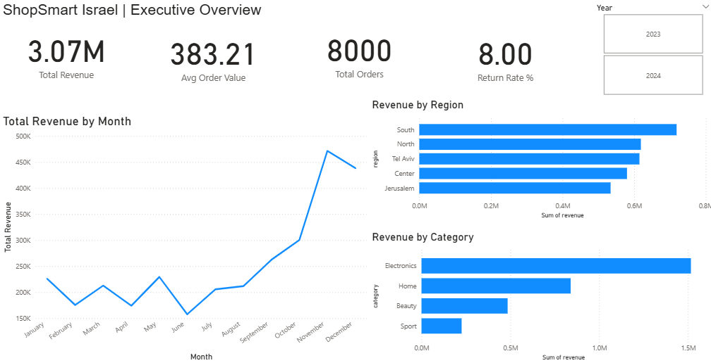
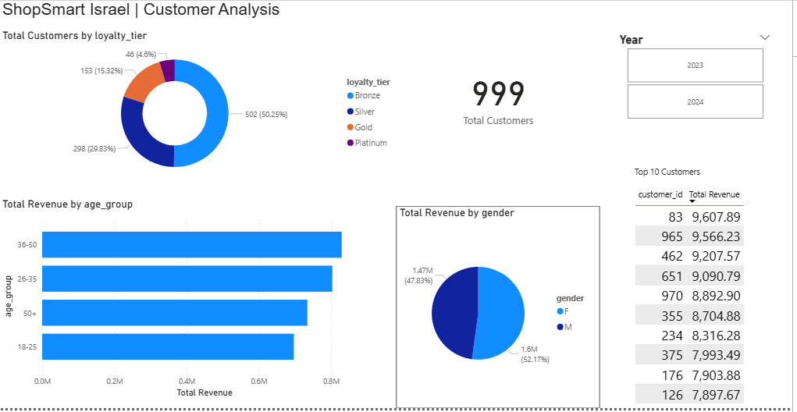
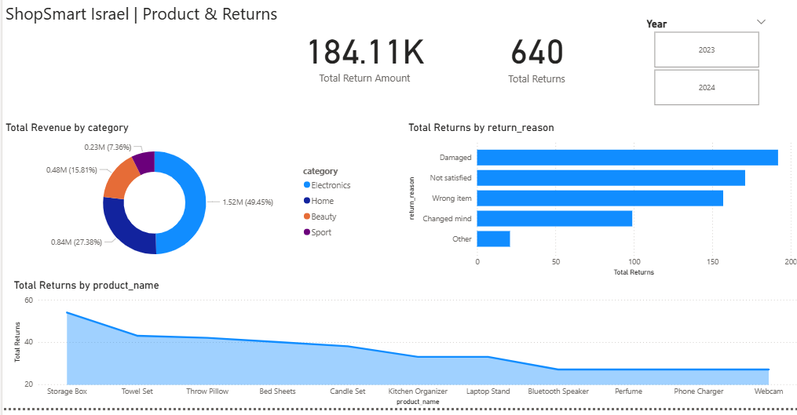
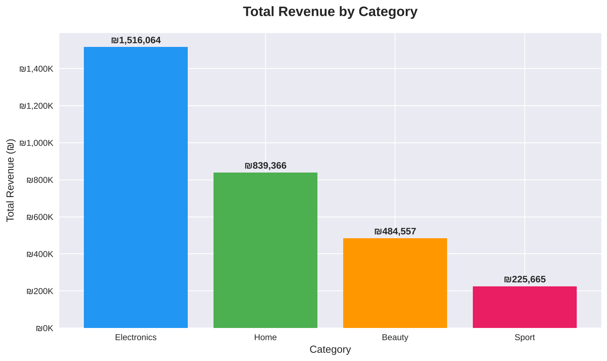
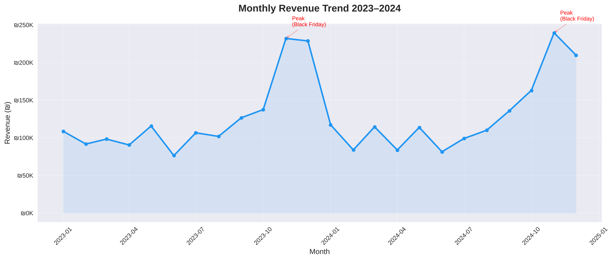
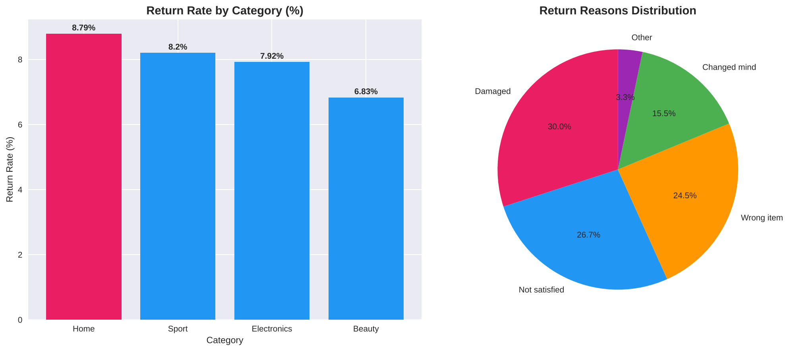
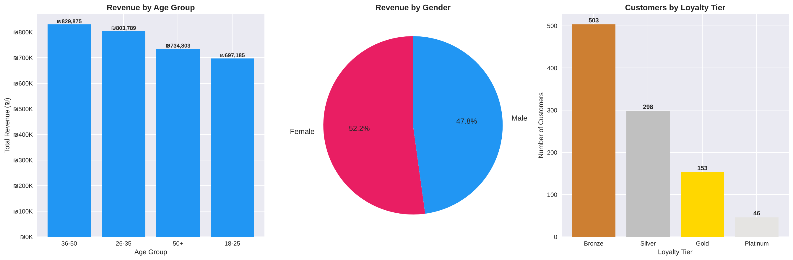

#  ShopSmart Israel — Retail Analytics Project

##  Project Overview
End-to-end data analytics project simulating real work as a Junior Data Analyst 
at a fictional Israeli e-commerce company "ShopSmart Israel".

##  Business Problem
The company's revenue is growing, but returns and category mix are putting pressure on results. 
Management needs to understand:
- Who are our most valuable customers?
- Which product categories drive the most revenue?
- Why are customers returning products?
- What are the seasonal trends in sales?

##  Tools Used
| Tool | Purpose |
|---|---|
| Python (pandas) | Dataset generation & EDA |
| SQL Server (SSMS) | Data analysis & KPI queries |
| Power BI | Interactive dashboard (screenshots below) |
| GitHub | Version control & portfolio |
| matplotlib / seaborn | Data visualization |

##  Dataset
Realistic synthetic dataset generated with Python:
- **orders** — 8,000 rows
- **customers** — 1,000 rows  
- **returns** — 640 rows
- **Date range:** 2023–2024
- **Total Revenue:** ₪3,065,652

##  Key Insights
-  **Electronics** is the top category generating 49% of total revenue
-  **South region** leads with ₪718,397 — driven by the largest customer base, not higher spend per customer
-  **November** is the peak month (Black Friday effect)
-  **Age group 36-50** generates the highest revenue
-  **Return rate is 8%** — Damaged items are the top return reason (30% of returns)
-  **Average Order Value: ₪383**

##  Business Recommendations
- **Reduce damaged-item returns** — damaged items are the top return reason (8% return rate)
- **Plan inventory and campaigns for November** — the peak sales month, driven by Black Friday
- **Focus marketing on the 36–50 age group** — the highest-revenue customer segment

Full analysis and recommendations: [Business Insights Report](business_insights.md)

##  Dashboard Screenshots

### Page 1 — Executive Overview


### Page 2 — Customer Analysis


### Page 3 — Product & Returns


##  Python EDA Visualizations

### Revenue by Category


### Monthly Revenue Trend


### Return Rate Analysis


### Customer Segmentation


##  How to Run
```bash
pip install -r requirements.txt
jupyter notebook
```
1. Run `generate_dataset.ipynb` — creates `data/customers.csv`, `data/orders.csv`, `data/returns.csv` 
   (the CSVs are already included in the repo, so this step is optional)
2. Run `shopsmart_eda_analysis.ipynb` — produces the 4 charts
3. Load the CSVs into SQL Server (database `ShopSmart`) and run `shopsmart_sql_analysis.sql`

##  Project Structure
```
shopsmart-retail-analytics/
├── data/                         # Generated CSVs: customers, orders, returns
├── generate_dataset.ipynb        # Python dataset generator
├── shopsmart_eda_analysis.ipynb  # Python EDA + visualizations
├── shopsmart_sql_analysis.sql    # 16 SQL analytical queries
├── business_insights.md          # Full analysis & recommendations
├── chart1_revenue_by_category.png
├── chart2_monthly_trend.png
├── chart3_return_analysis.png
├── chart4_customer_segmentation.png
├── page1_executive.png           # Power BI dashboard
├── page2_customers.png
├── page3_products.png
└── requirements.txt
```
